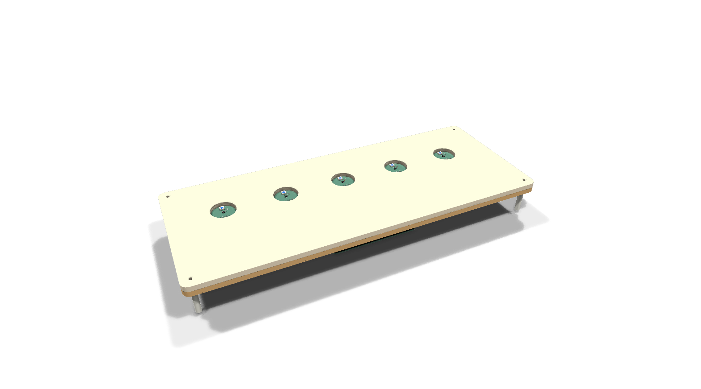
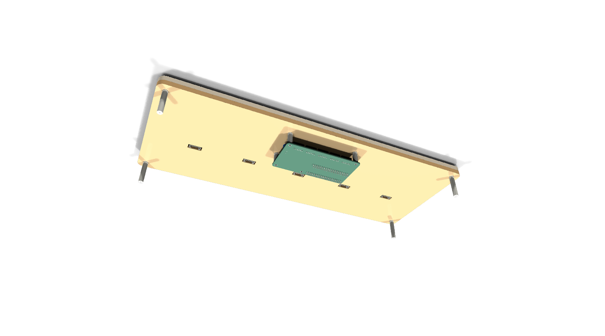
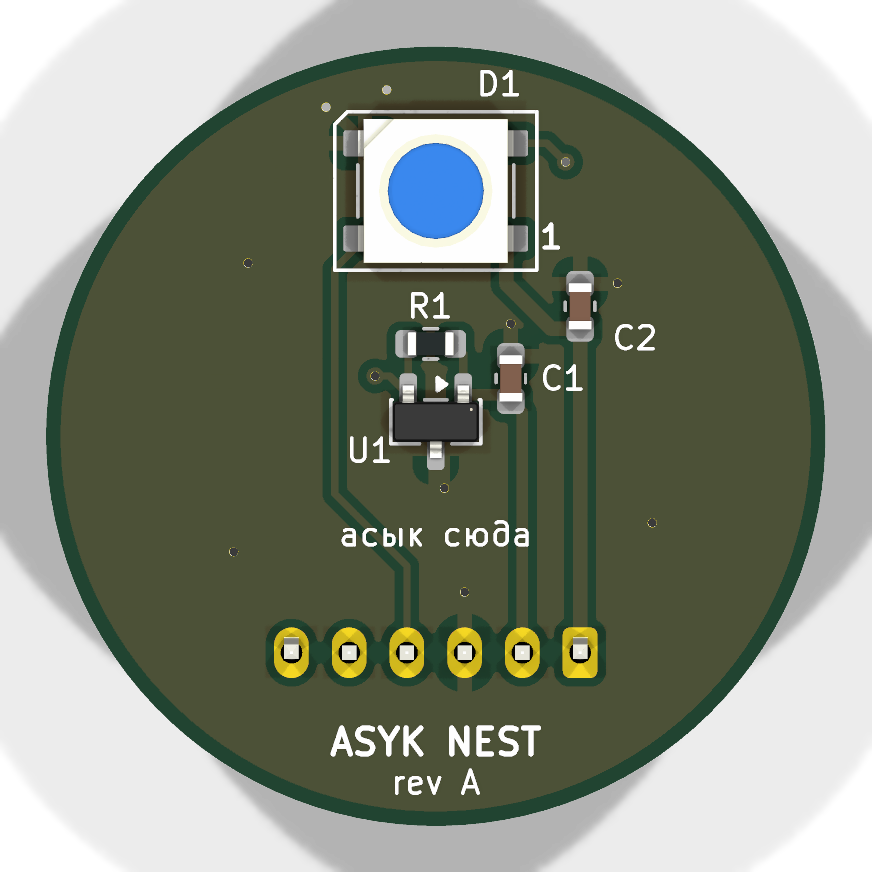
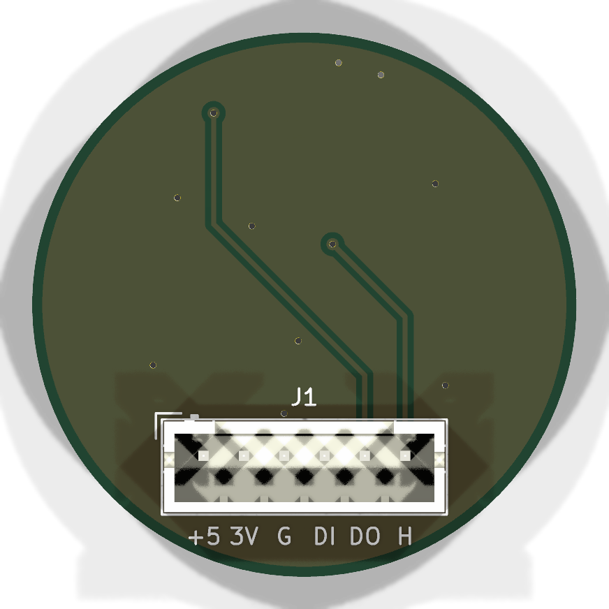
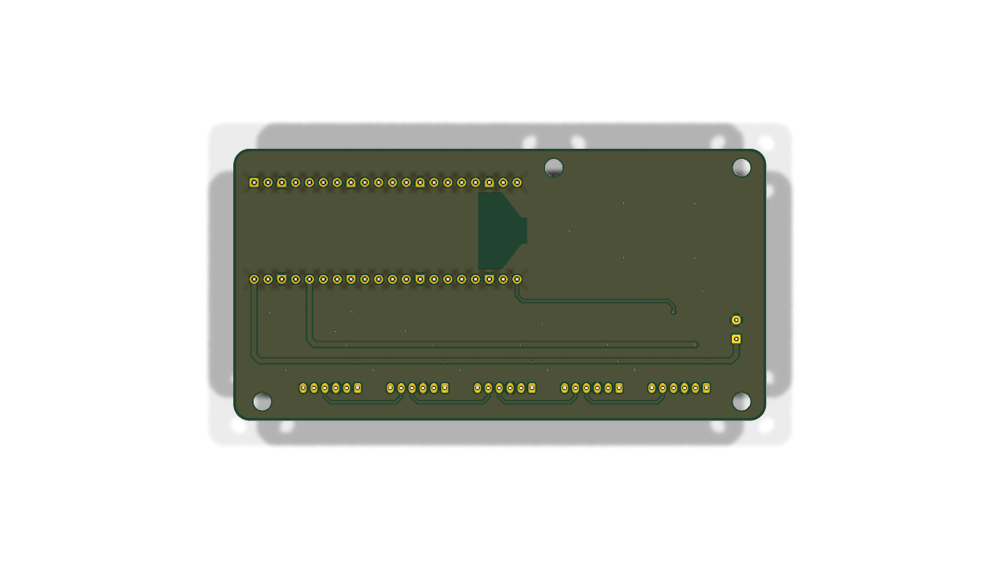
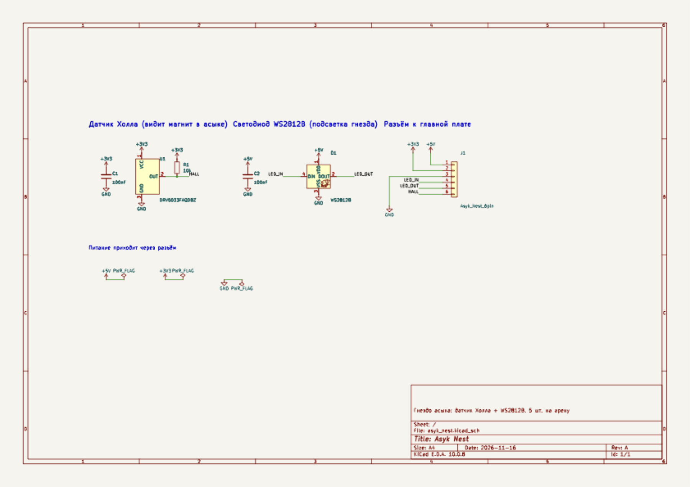

# Asyk Arena

## What it is & how to play
Asyk Arena is an electronic version of the Kazakh game of asyks. You put asyks on 5 nests, flick the saqa and try to knock them down. Each asyk has a magnet inside, and there is a Hall sensor under each nest, so the arena sees by itself which asyks were knocked down, lights up the nests and counts the points.

## Why I made it
I wanted to take a real Kazakh folk game and show it in a new way, through electronics. Many people know asyks, but few have seen the game count the points by itself.

## How AI helped
I don't know electronics well, so the schematics, PCB layouts and factory files in KiCad were made by AI (Claude). I decided what the arena should do and how complex the circuit should be, checked the result and learned from its files. The idea, the game rules and the arena plan are ours.

*(I wrote this README text in Russian myself and translated it to English with AI.)*

## Full 3D assembly

STEP file: [hardware/3d/asyk_arena_assembly.step](hardware/3d/asyk_arena_assembly.step)

| Part | Details |
|---|---|
| Top plate | birch plywood 400×160×6 mm, 5 holes Ø28 mm every 70 mm for the nest boards |
| Bottom plate | birch plywood 400×160×6 mm, a slot under each nest for the cable |
| Main board | hangs under the bottom plate on 4× M3 brass standoffs 16 mm, Pico facing up |
| Legs | 4× M3 standoffs 30 mm in the corners, also clamp the plates together |

## PCB
**Nest board** (×5)

**Main board**

## Schematic

## Files
| What | Where |
|---|---|
| Nest board (KiCad) | [hardware/nest](hardware/nest) |
| Main board (KiCad) | [hardware/main-board](hardware/main-board) |
| Gerbers, BOM, pick-and-place | `hardware/*/fab/` |
| Arena 3D model (STEP) | [hardware/3d](hardware/3d) |
| Firmware | [firmware](firmware) |

## Demo video (build submission)

## Photos of the final product (build submission)

## BOM
See [bom.csv](bom.csv).
