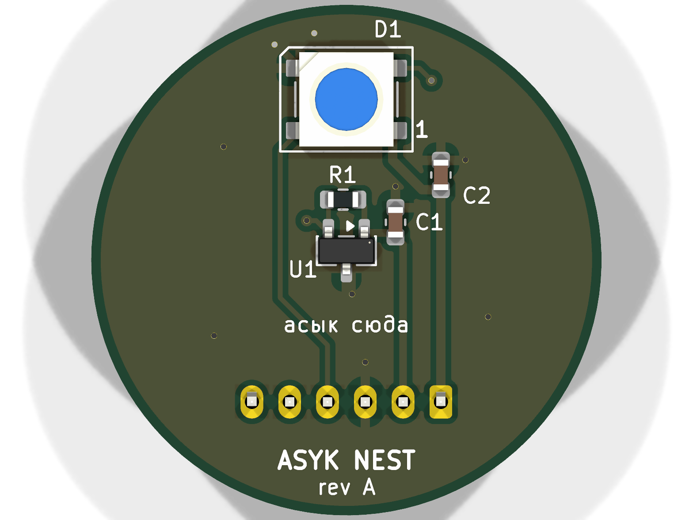
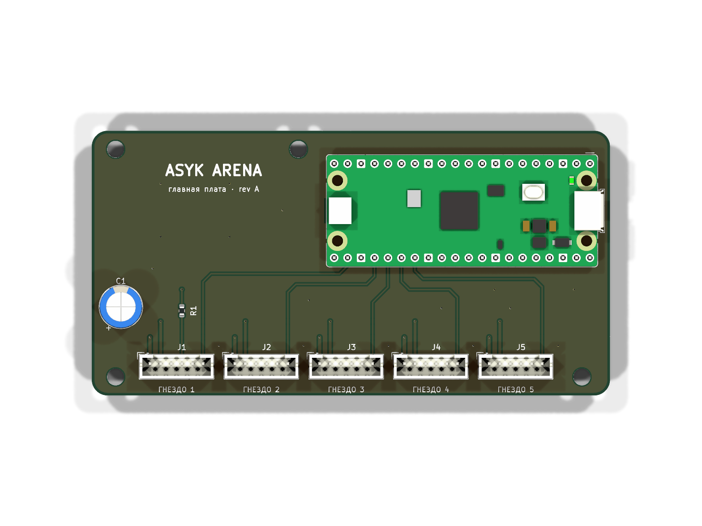
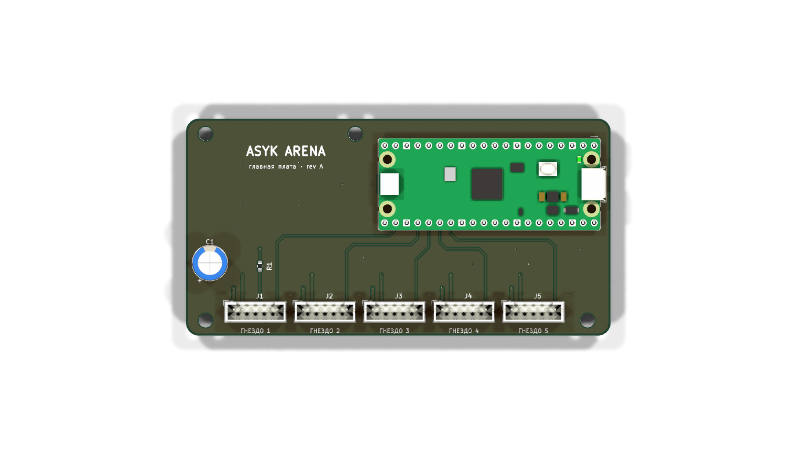
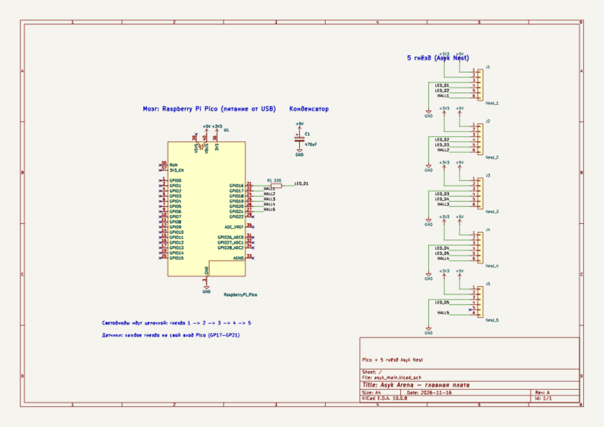

# Asyk Arena

<!-- Разделы, которые требует Fallen. Текст пиши своими словами. -->

## What it is & how to use it

## Why I made it

## Full 3D assembly
<!-- 3D-модели арены пока нет: добавь сюда скриншот, когда сделаешь её -->

## PCB
**Nest board** (×5)

**Main board**

## Schematic

## Files
| What | Where |
|---|---|
| Nest board (KiCad) | [hardware/nest](hardware/nest) |
| Main board (KiCad) | [hardware/main-board](hardware/main-board) |
| Gerbers, BOM, pick-and-place | `hardware/*/fab/` |
| Firmware | [firmware](firmware) |

## Demo video (build submission)

## Photos of the final product (build submission)

## BOM
See [bom.csv](bom.csv).
